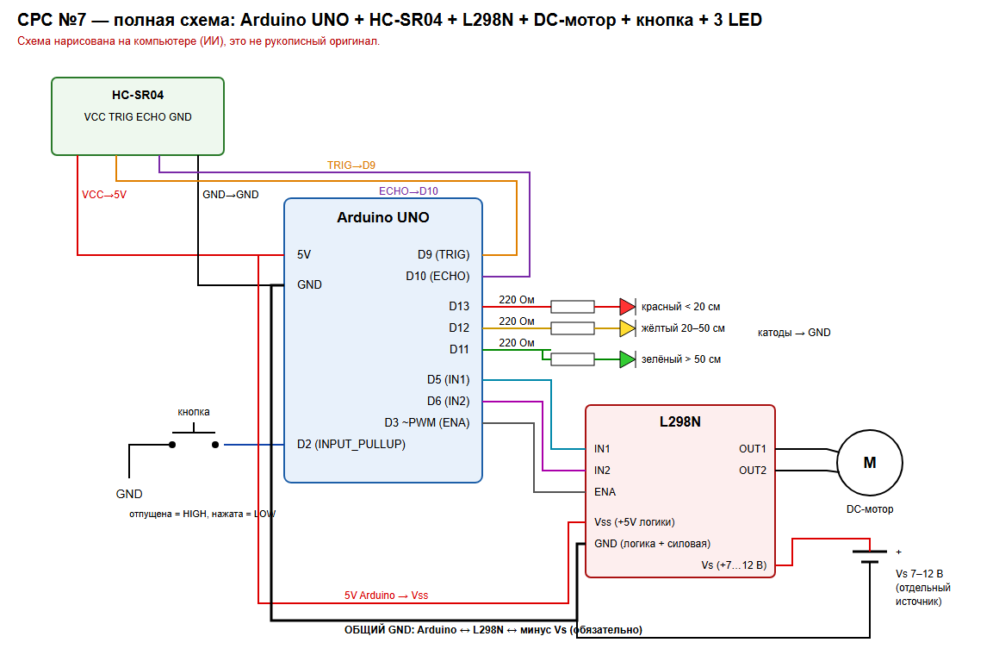

# Схема, таблица истинности и прогнозы

> Эти материалы нарисованы и набраны на компьютере (ИИ-ассистент Claude). Это **не** рукописный оригинал из тетради. Если преподаватель требует именно фото тетради, их нужно перерисовать от руки и добавить сюда.

## Полная схема

Исходник: [schematic_srs7.svg](schematic_srs7.svg).

Подписи: HC-SR04 (VCC→5V, GND→GND, TRIG→D9, ECHO→D10); кнопка D2↔GND (INPUT_PULLUP); LED D13/D12/D11 через собственные 220 Ом на GND; L298N: IN1←D5, IN2←D6, ENA←D3 (ШИМ), Vss←5V Arduino, GND логики и силовой — **общий** с Arduino и минусом Vs; Vs — отдельный источник 7–12 В; OUT1/OUT2 → DC-мотор.

## Таблица истинности L298N (до запуска)

| IN1 | IN2 | ENA | Мотор |
|---|---|---|---|
| X | X | 0 (LOW) | свободный выбег (остановка по инерции) |
| HIGH | LOW | PWM 1–255 | вперёд, скорость ∝ скважности |
| LOW | HIGH | PWM 1–255 | назад, скорость ∝ скважности |
| HIGH | HIGH | PWM 1–255 | быстрое торможение (клеммы мотора замкнуты) |

## Прогноз при нажатой кнопке

| Расстояние | LED | Мотор | ENA |
|---|---|---|---|
| 10 см | красный | стоп | 0 |
| 20 см | жёлтый | вперёд | 120 |
| 35 см | жёлтый | вперёд | 120 |
| 50 см | жёлтый | вперёд | 120 |
| 70 см | зелёный | вперёд | 255 |

## Безопасное состояние

`pulseIn() = 0` (эха нет), отпущенная кнопка или некорректный замер → мотор стоп (IN1 = IN2 = LOW, ENA = 0), все LED выключены, ошибка в Serial. Ошибка датчика ≠ «путь свободен».
